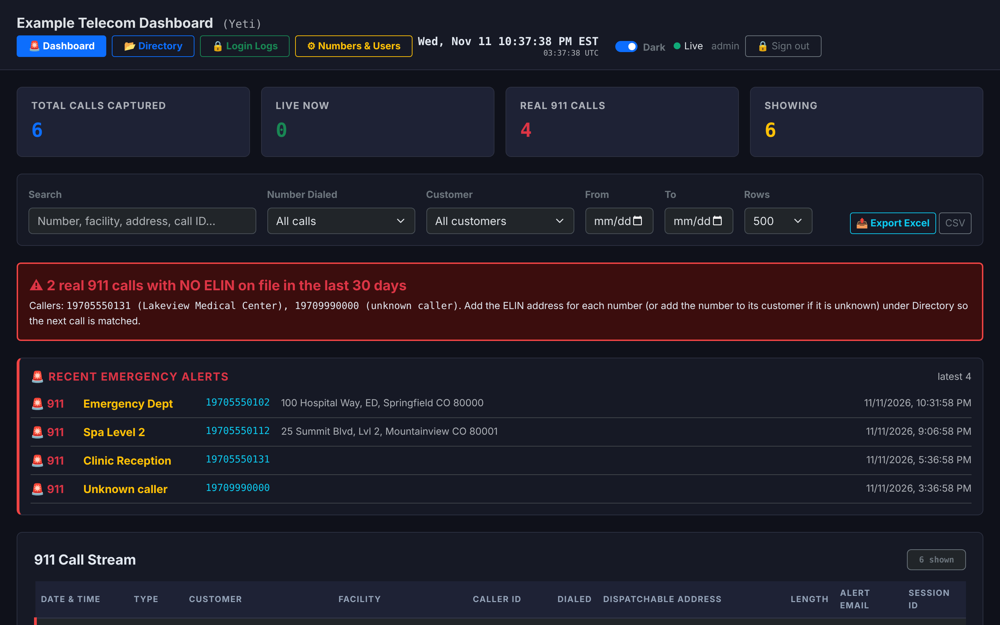
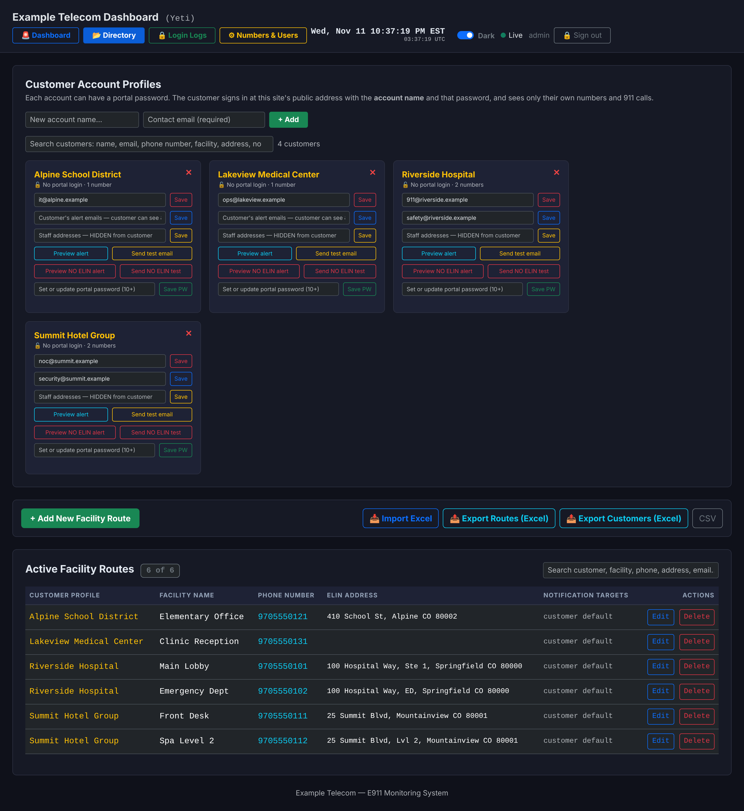
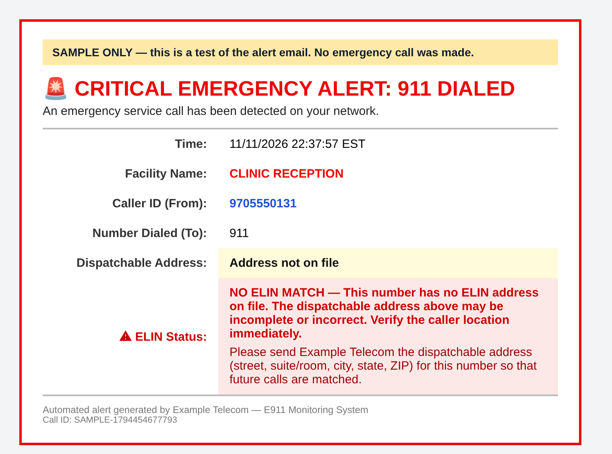

# Yeti-E911

911 call detection and alerting for the [Yeti Switch](https://yeti-switch.org/) SBC, with a multi-customer portal.

Yeti-E911 watches your Yeti for calls to 911 (and the 933 test number), records each one, looks up the caller's number in your customer ELIN list, and emails the customer and your staff the facility and dispatchable address. A real 911 call from a number with no address on file raises a separate, urgent alert.



*Demo data only: the names, numbers and addresses are fictional.*

> **Important: read before relying on it.**
> Yeti-E911 only **watches and alerts**. It does **not** route 911 calls and is **not** a certified E911 service or a substitute for one. Your Yeti must already route 911 to an emergency carrier, and you are responsible for your carrier, PSAP and regulatory obligations. Alerts depend on your Yeti, network, database and email provider all working. Test with your carrier before depending on it. It is provided "as is", without warranty (see [LICENSE](LICENSE)).

## Features

- **Live and after-the-fact capture.** Reads active calls from the Yeti admin API every 2 seconds, and finished calls from the CDR database every 60 seconds, so a call missed live is still recorded and alerted (marked as late).
- **Call event stream.** `call.initiated`, `call.answered`, `call.hangup` for every emergency call.
- **Customers, numbers and ELIN addresses.** Add, edit and search in the web UI, or import and export Excel/CSV. Numbers are matched on their last 10 digits, so `9705550101`, `19705550101` and `+19705550101` are the same number.
- **Two emails per alert, never mixed.** The customer gets one email. Staff get a separate copy. A customer never sees a staff address.
- **NO ELIN MATCH alerts.** A real 911 call from a number with no address on file (or no number on file at all) is sent as a high-priority urgent alert, shown in a dashboard banner, and optionally priced with `NO_ELIN_FEE` if your carrier charges for such calls.
- **Customer portal.** Customers sign in to see only their own numbers and calls, and manage their own notification emails.
- **Admin separation.** Admin accounts can sign in only through the internal address of your reverse proxy, not from the internet.
- **Admin tools.** User management, a login log, preview and test-send for alerts, a clock, and configurable call patterns.

## Screenshots

| | |
|---|---|
| **Directory**: customer profiles with search, plus facility routes and ELIN addresses | **NO ELIN MATCH alert email**: the urgent customer copy |
|  |  |

## How it works

```
Yeti SBC ──API (live calls)──┐
                             ├─► watcher ─► Postgres ◄─ web app ◄─ reverse proxy ◄─ staff / customers
Yeti CDR database ──(late)───┘      │
                                    └─► SMTP2GO ─► customer and staff inboxes
```

- A call is **real** when the dialed number matches `911` or `1911`, and a **test** when it matches `933`, `1933`, `19133`, `15555550911` or `5555550911`. The patterns are editable in the UI.
- The same call seen live and in the CDR is merged by call ID: one record, one alert.
- Node.js/Express and PostgreSQL, run under PM2. Vendored Bootstrap 5 for the UI. No build step.

## Requirements

- A Yeti Switch with the admin REST API reachable from this host, and read access to its CDR database (a read-only role is enough).
- Linux server (developed on Debian 13), Node.js 20.6 or newer, PostgreSQL (tested on 16 and 17), a reverse proxy with TLS (nginx example included).
- An [SMTP2GO](https://www.smtp2go.com/) account and API key for sending email. Other providers are not supported yet.
- North American (US/Canada) 10-digit numbers. Other numbering plans are not supported.

Tested against the Yeti admin API and the `cdr.cdr` CDR table of the Yeti Switch release the author runs (2026). Column names can differ between Yeti versions; check `\d cdr.cdr` and adjust the query in `watcher.js` if needed.

## Quick start

See **[INSTALL.md](INSTALL.md)** for the full guide. In short:

```
git clone https://github.com/posi211/Yeti-E911.git /opt/yeti-e911 && cd /opt/yeti-e911
npm install --omit=dev
cp .env.example .env && chmod 600 .env        # fill it in
# create the database and load schema.sql (see INSTALL.md)
node --env-file=.env create-user.js admin 'a-long-password'
pm2 start ecosystem.config.js && pm2 save
```

Then dial 933 from a test line and watch a call appear on the dashboard.

## Configuration

Everything is set in `.env`; every option is documented in [.env.example](.env.example). Secrets are never stored in the code or the database schema.

## Security model

- Passwords are hashed with scrypt. Sessions are signed, HTTP-only cookies. Failed logins are throttled and logged.
- The app listens on `127.0.0.1` only. Your reverse proxy sets an `X-E911-Internal` header (`1` for the staff site, `0` for the public site) and **overwrites** anything the client sends. The app refuses admin sessions unless it is `1`. **This only works if the proxy is configured as in INSTALL.md and nothing else can reach port 3100.**
- Customers can see only their own data. Staff addresses and fees are never sent to customer browsers or inboxes.
- Imports and exports guard against spreadsheet formula injection.
- Use a read-only database role for the CDR and, ideally, a read-only Yeti API user.

To report a vulnerability, see [SECURITY.md](SECURITY.md).

## Tests

```
npm test            # fast self-test, no database needed
npm run test:all    # also needs a scratch PostgreSQL, see CONTRIBUTING.md
```

## License

Apache License 2.0. See [LICENSE](LICENSE) and [NOTICE](NOTICE).
